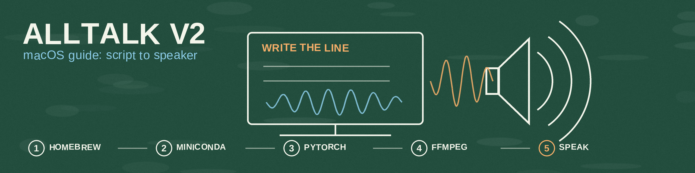

# AllTalk-V2-MacOS-Guide
Updated Guide to installing AllTalk v2 on macOS

```
/bin/bash -c "$(curl -fsSL https://raw.githubusercontent.com/Homebrew/install/HEAD/install.sh)"
brew unlink espeak
brew install espeak ffmpeg gcc git curl espeakng
xcode-select --install
git clone -b alltalkbeta https://github.com/erew123/alltalk_tts
cd alltalk_tts
mkdir alltalk_environment
cd alltalk_environment
curl -LO https://repo.anaconda.com/miniconda/Miniconda3-latest-MacOSX-arm64.sh
bash Miniconda3-latest-MacOSX-arm64.sh -b -p $PWD/conda
./conda/bin/conda create --no-shortcuts -y -k --prefix ../env python=3.11.9
source ./conda/bin/activate ../env
./conda/bin/conda install -y pytorch==2.2.1 torchvision==0.17.1 torchaudio==2.2.1 -c pytorch
./conda/bin/conda install -y -c conda-forge faiss-cpu
./conda/bin/conda install -y -c conda-forge "ffmpeg=*=*gpl*"
cd ..
nano -w system/requirements/requirements_standalone.txt
# Change onnxruntime-gpu>=1.18.1 to onnxruntime>=1.18.1

# Interesting Part: Obtain the wheel file from here:
https://github.com/rhasspy/piper-phonemize/issues/14#issuecomment-2094395478 && https://github.com/rhasspy/piper-phonemize/files/15210981/piper_phonemize-1.1.0-cp311-cp311-macosx_11_0_arm64.whl.zip
unzip in the alltalk_environment folder and then pip install piper_phonemize-1.1.0-cp311-cp311-macosx_11_0_arm64.whl

^ Follow the compile steps if you do not trust the wheel file.

pip install -r system/requirements/requirements_standalone.txt
pip install --upgrade gradio==4.32.2
pip install -r system/requirements/requirements_parler.txt
./alltalk_environment/conda/bin/conda clean --all --force-pkgs-dirs -y
pip install --upgrade transformers==4.49.0
pip install pip==24.0
pip install git+https://github.com/liyaodev/fairseq.git
python script.py
# Then select XTTS v2 in the app
```

## Scope note

This repo is instructions only; it contains no code of its own. The steps above are for an Apple Silicon Mac (note the `MacOSX-arm64` Miniconda installer and the `macosx_11_0_arm64` wheel). The pinned versions in the steps (Python 3.11.9, PyTorch 2.2.1, Gradio 4.32.2, Transformers 4.49.0, pip 24.0) are reproduced exactly as written; they were not re-verified against current releases in this pass, because a live install was not attempted and the upstream sites are outside this pass's allowed hosts. Treat the pins as the guide's dated snapshot, and check the AllTalk project for newer versions before installing. The two fixes in this pass are the directory-name typo above (the folder is `alltalk_environment`, not `alltalk_enviornment`) and the last step, which previously read as a single shell command with a parenthetical that a shell cannot parse.
