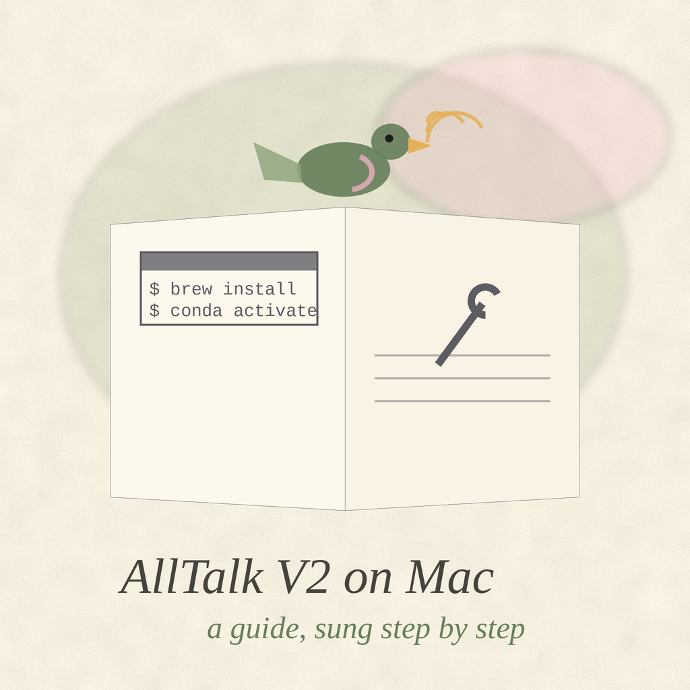

# AllTalk-V2-MacOS-Guide

Updated Guide to installing AllTalk v2 on macOS


<p align="center"></p>

**The Speaking Astrolabe**
_Brass, teal, and patience: ordered reckoning that ends with a machine speaking._

> [!IMPORTANT]
> Brass plaque: mind the folder spelling. The folder is alltalk_environment, and a folder created under one name and entered under another ends the trip early.

The steps run in order. Each section assumes the ones before it are done, and the working directory matters: the environment is created inside the cloned repo, then the guide steps back out of it before the requirements are installed.

[1. Homebrew and command line tools](#1-homebrew-and-command-line-tools) · [2. Clone AllTalk and create the environment folder](#2-clone-alltalk-and-create-the-environment-folder) · [3. Miniconda and the Python environment](#3-miniconda-and-the-python-environment) · [4. Fix the standalone requirements for Apple Silicon](#4-fix-the-standalone-requirements-for-apple-silicon) · [5. The piper-phonemize wheel](#5-the-piper-phonemize-wheel) · [6. Install the requirements and the final upgrades](#6-install-the-requirements-and-the-final-upgrades) · [7. Run](#7-run) · [Scope note](#scope-note)

## Quick Start

The full guide is the seven stations below, in order:

1. Install Homebrew and the command line tools (Station 1).
2. Clone AllTalk on the alltalkbeta branch and create the alltalk_environment folder (Station 2).
3. Install Miniconda (arm64) and create the Python 3.11.9 environment (Station 3).
4. Change onnxruntime-gpu to onnxruntime in the standalone requirements (Station 4).
5. Install the piper-phonemize wheel (Station 5).
6. Install the requirements and the final upgrades (Station 6).
7. Run `python script.py`, then select XTTS v2 in the app (Station 7).

## 1. Homebrew and command line tools
_Station 1 of 7 · the first brass fitting_


```
/bin/bash -c "$(curl -fsSL https://raw.githubusercontent.com/Homebrew/install/HEAD/install.sh)"
brew unlink espeak
brew install espeak ffmpeg gcc git curl espeakng
xcode-select --install
```

## 2. Clone AllTalk and create the environment folder
_Station 2 of 7 · laying out the plate_

```
git clone -b alltalkbeta https://github.com/erew123/alltalk_tts
cd alltalk_tts
mkdir alltalk_environment
cd alltalk_environment
```

## 3. Miniconda and the Python environment
_Station 3 of 7 · the heavy casting_

```
curl -LO https://repo.anaconda.com/miniconda/Miniconda3-latest-MacOSX-arm64.sh
bash Miniconda3-latest-MacOSX-arm64.sh -b -p $PWD/conda
./conda/bin/conda create --no-shortcuts -y -k --prefix ../env python=3.11.9
source ./conda/bin/activate ../env
./conda/bin/conda install -y pytorch==2.2.1 torchvision==0.17.1 torchaudio==2.2.1 -c pytorch
./conda/bin/conda install -y -c conda-forge faiss-cpu
./conda/bin/conda install -y -c conda-forge "ffmpeg=*=*gpl*"
cd ..
```

## 4. Fix the standalone requirements for Apple Silicon
_Station 4 of 7 · filing the edges true_

```
nano -w system/requirements/requirements_standalone.txt
```

In that file, change `onnxruntime-gpu>=1.18.1` to `onnxruntime>=1.18.1`. The GPU build does not apply on this platform; the plain package is the one section 6 installs.

## 5. The piper-phonemize wheel
_Station 5 of 7 · the small wheel, fitted_

Interesting part: obtain the wheel file from here: https://github.com/rhasspy/piper-phonemize/issues/14#issuecomment-2094395478
The file itself: https://github.com/rhasspy/piper-phonemize/files/15210981/piper_phonemize-1.1.0-cp311-cp311-macosx_11_0_arm64.whl.zip

Unzip in the alltalk_environment folder and then pip install piper_phonemize-1.1.0-cp311-cp311-macosx_11_0_arm64.whl

Follow the compile steps at the first link instead if you do not trust the wheel file.

## 6. Install the requirements and the final upgrades
_Station 6 of 7 · polish and assembly_


```
pip install -r system/requirements/requirements_standalone.txt
pip install --upgrade gradio==4.32.2
pip install -r system/requirements/requirements_parler.txt
./alltalk_environment/conda/bin/conda clean --all --force-pkgs-dirs -y
pip install --upgrade transformers==4.49.0
pip install pip==24.0
pip install git+https://github.com/liyaodev/fairseq.git
```

## 7. Run
_Station 7 of 7 · the first sound_

```
python script.py
```

Then select XTTS v2 in the app.

## Scope note
_The colophon, read before the first fitting_


This repo is instructions only; it contains no code of its own. The steps above are for an Apple Silicon Mac (note the `MacOSX-arm64` Miniconda installer and the `macosx_11_0_arm64` wheel). The pinned versions in the steps (Python 3.11.9, PyTorch 2.2.1, Gradio 4.32.2, Transformers 4.49.0, pip 24.0) are reproduced exactly as written; they were not re-verified against current releases in this pass, because a live install was not attempted and the upstream sites are outside this pass's allowed hosts. Treat the pins as the guide's dated snapshot, and check the AllTalk project for newer versions before installing. The two fixes in this pass are the directory-name typo above (the folder is `alltalk_environment`, not `alltalk_enviornment`) and the last step, which previously read as a single shell command with a parenthetical that a shell cannot parse.

## Visual Identity

<p align="center"></p>

<p align="center"></p>


